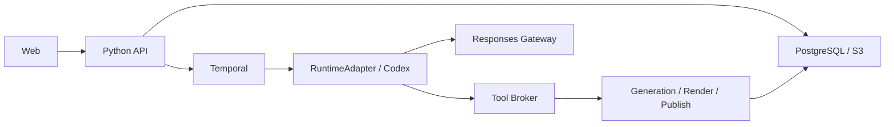

# 架构与实现策略

## 业务边界

采用模块化单体加独立 Worker。Web 通过 HTTP/SSE 访问 Python API；API 管理业务事实；RuntimeAdapter 控制 Codex；Tool Broker 注入可信身份；Worker 执行采集、生成、渲染与发布。PostgreSQL 保存元数据与 outbox，S3 保存字节，Temporal 管理持久任务，Redis 只做短期协调。

## 实现顺序

先稳定无外部依赖的合同，再接真实 Runtime，通过 G0 后实现文章闭环。合同使用冻结 dataclass 与显式验证；HTTP Schema 使用 Pydantic。真实业务 API 出现时统一生成 TypeScript 类型。B00 不预装未使用的 SDK、ORM 或媒体库。

统一身份与版本，分别保留文章 AST、图片图层、SceneSpec、DeckSpec、视频时间轴及分析快照。Rendition 绑定具体 ArtifactVersion。

局部修改携带 base_version_id、object_id、范围与原文 hash，冲突拒绝。版本创建使用数据库条件更新。B00 SelectionRef 仅验证基础版本与选区原文，尚无编辑引擎或持久版本库。

Run 独立于 Codex Turn，可在 waiting_external 跨越多个 Turn。业务 completed 必须经过产物与 Job 验证；B00 状态转换只验证合法边。持久租约、fencing、回调去重与取消恢复在 G0/G1 实现。

## 目录职责

| 目录 | 当前职责 |
| --- | --- |
| `contracts` | Run 状态转换、ArtifactRef、SelectionRef |
| `runtime_adapter` | 异步 Protocol，尚无真实实现 |
| `api` | 存活、未就绪与能力探针 |
| `web` | React/TypeScript/Vite 起始页与代理 |
| `scripts` | 检查、输入哈希、日志与报告 |
| `references` | 完整需求与来源 |
| `infrastructure` | 服务边界与后续部署计划 |

## 依赖策略

Python 直接依赖固定版本，`requirements-dev.lock` 约束传递版本；前端提交 package-lock。SDK 与匹配 Runtime 在 G0-01 单独锁定。升级重跑对应检查，不能继承其他项目的验收结论。

[官方 Codex SDK 文档](https://learn.chatgpt.com/docs/codex-sdk) 于 2026-11-03 核对。RuntimeAdapter 为本项目协议，不是 SDK 原始方法签名。
