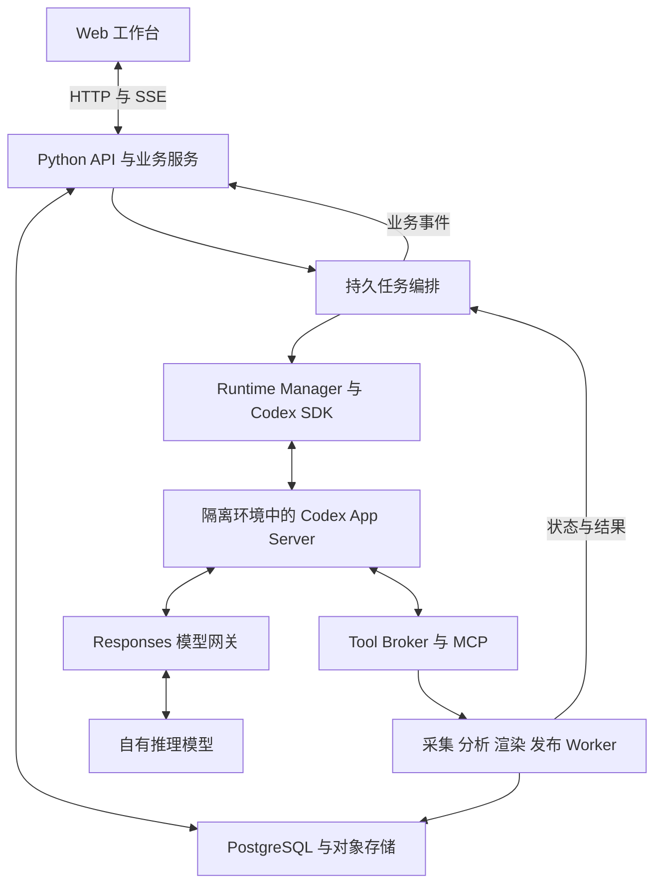
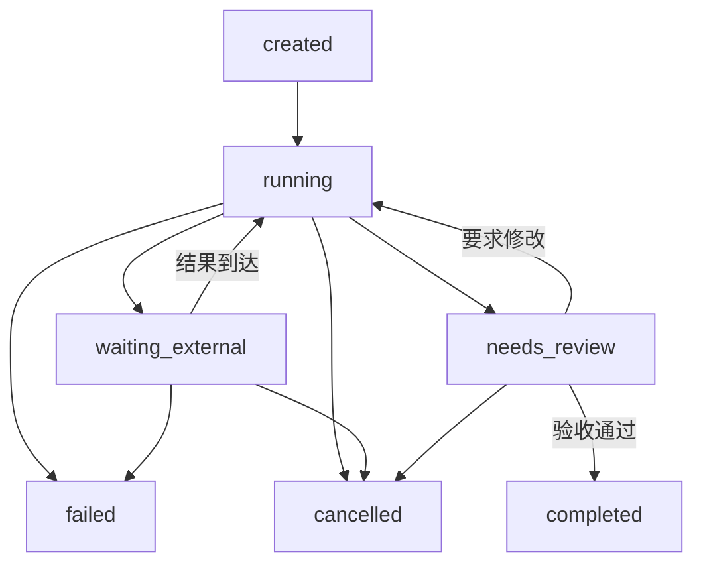

# Python 和 Codex SDK 智能创作工作台完整技术方案

来源：https://chatgpt.com/space/page_e99edc1694448191929c401a9ff2dda2

读取日期：2026-11-03。以下为设计来源快照，不表示已实现。

目标是构建一个以对话驱动的智能创作工作台，覆盖文章、图片、信息图、PPT、视频的创作、局部编辑、预览、导出与发布，并支持资料采集、数据分析和发布效果回收。产品采用 ChatGPT 类似的连续对话体验，复杂产物在工作区中编辑，长任务在后台持续执行。

推荐架构为 React 和 TypeScript 前端、Python 业务平台、Codex Python SDK 与独立 App Server 运行环境、自有模型网关、统一产物服务、持久任务编排，以及按内容类型划分的渲染 Worker。Codex 负责理解、规划和工具调用；平台维护业务事实、权限、版本和任务状态；生成与渲染服务执行可验证的工作。

自有模型必须先通过 Responses API 与 Agent 工具循环验收。图片与视频模型通过平台工具适配器接入，不要求全部实现 Codex 的模型协议。本文中的架构、数据模型和接口是本项目的推荐设计；引用的官方文档用于说明底层产品与库的能力边界。

设计基准日期为 2026 年 11 月 3 日。初期按单区域部署、支持个人和小团队、多租户数据隔离设计；容量通过并发和任务队列配置扩展，不预设某个模型、云厂商或发布平台。

# 产品交互与工作区

界面分为项目导航、对话区和产物工作区。项目包含会话、资料、品牌资料、素材、产物、发布记录和分析结果。对话区展示公开回复、操作进度、工具结果、产物卡片和需要用户处理的决定。工作区根据产物切换文章编辑器、图层画布、幻灯片编辑器、视频时间轴或数据分析视图。

输入支持文本、文件、链接、图片、选择范围和已有产物引用。用户可以要求“把选中的第二段改短”“把第 5 页的图表换成最新数据”“保留字幕，只更换第 3 个镜头”。前端把选择信息转为带版本的结构化引用，不仅发送一句自然语言。

| 交互 | 产品行为 |
| --- | --- |
| 创建 | 用户描述需求，Agent 组织资料与步骤，逐步生成可预览产物 |
| 修改 | 用户选中对象或范围，生成可审阅修改，提交后形成新版本 |
| 比较 | 展示文本差异、页面前后对照、图层变化或视频区间变化 |
| 打断 | 明确区分停止当前回答、取消生成任务、取消尚未执行的发布 |
| 补充要求 | 进入当前 Turn 的 steering，或排入下一轮，界面显示采用哪一种 |
| 审阅和发布 | 展示将发布的具体版本、账户、渠道、可见范围与时间 |
| 重连 | 从持久事件与产物状态恢复，不重复执行用户操作 |

产物卡片最少展示名称、类型、版本、状态、缩略图或播放器、查看、编辑、导出和发布入口。实现细节如工具内部名、容器路径和模型协议不进入日常创作流程。仅展示面向用户的操作摘要，不默认展示原始 reasoning 或凭证信息。

# 系统边界与总体架构



| 层 | 应承担的职责 |
| --- | --- |
| Web 工作台 | 输入、选择、编辑、预览、版本比较、审批与进度 |
| Python 业务服务 | 用户、组织、项目、权限、产物、账本、发布与业务状态 |
| Codex Runtime | Agent 循环、会话、模型请求、工具调用、上下文管理 |
| Model Gateway | 模型协议、能力声明、认证、限流、路由与用量 |
| Tool Broker | 注入可信身份、鉴权、幂等、预算、工具调用与结果登记 |
| Workflow 与 Worker | 可靠调度、外部任务追踪、渲染、重试、取消与补偿 |

初期采用模块化单体加独立 Worker。API、Runtime Worker、渲染 Worker 和发布 Worker 可以独立部署，但业务模块先保持在一个 Python 代码库和一套清晰的模块接口内。不要从第一天就把每个模块拆成网络微服务。

Codex Thread 是执行会话，不替代平台 Project、Conversation、Run 和 Artifact。Codex 的本地历史也不替代业务数据库。应用拥有业务状态，Runtime 通过适配层交换命令和事件。

# 推荐技术栈

| 部分 | 首选方案 | 选择理由与边界 |
| --- | --- | --- |
| 前端 | React 与 TypeScript，Vite | 适合复杂编辑器；首期应用以交互为主，不要求服务端渲染 |
| 界面状态 | TanStack Query 与 Zustand | 分开管理服务器状态与编辑器临时状态 |
| 文章编辑 | Tiptap 开源核心与自定义节点 | JSON 文档模型；商业扩展单独评估，不作为基础依赖 |
| 二维编辑 | Konva 与 react-konva | 实现图层、选择、变换和局部编辑；不是完整设计编辑器成品 |
| Python API | FastAPI，Pydantic，SQLAlchemy，Alembic | 类型化接口、权限与持久化 |
| Agent 接入 | openai-codex，AsyncCodex | 通过 JSON-RPC 驱动本地 App Server，固定 SDK 和 Runtime 版本 |
| 业务数据库 | PostgreSQL | 元数据、权限、产物版本、事件、任务与发布账本 |
| 短期协调 | Redis | 缓存、速率限制、通知；不作为唯一任务记录 |
| 文件存储 | S3 兼容对象存储 | 原始素材、规范源文件、预览、导出与日志附件 |
| 长任务 | Temporal Python SDK | 跨进程工作流、等待外部结果、定时触发与人工决定 |
| 分析 | DuckDB 与 Polars | 对受控 CSV、Parquet 等快照做 SQL 与数据计算 |
| 文档导出 | python-docx 与受控 HTML PDF 渲染 | 编辑源与导出格式分离 |
| PPT | python-pptx，LibreOffice，Poppler | 可编辑 PPTX、PDF 与图片预览；覆盖范围需明确 |
| 图片与信息图 | Pillow，SVG 编译器与固定字体渲染 | 生成图像与精确文字、图表分别处理 |
| 视频 | FFmpeg，ffprobe，ASR 与 TTS 适配器 | 合成、转码、字幕、音频和时长校验 |
| 浏览器采集 | httpx 与独立 Playwright Worker | 静态与动态页面采用不同采集路径 |
| 观测 | OpenTelemetry，Prometheus 与 Grafana | 贯通业务任务、模型、工具与渲染链路 |

[Tiptap 持久化](https://tiptap.dev/docs/editor/core-concepts/persistence)、[Konva React](https://konvajs.org/docs/react/index.html)、[python-pptx](https://python-pptx.readthedocs.io/en/latest/)、[Temporal Python](https://docs.temporal.io/develop/python)提供对应基础能力。上述库需要组成平台，不能直接等同于完整工作台。实际锁定依赖时保存版本与许可证清单，商业编辑器或服务另行决策。

# 自有模型接入与兼容性验收

Codex 的自定义 provider 要求兼容 Responses API。只有 Chat Completions 或 Anthropic Messages 接口，并不能证明可以接入。网关必须保留流事件、结束事件、历史输入、function call 与匹配的 function_call_output。依据为[官方网关兼容要求](https://learn.chatgpt.com/docs/enterprise/gateway-compatibility)。

推荐让 Codex 连接一个稳定的内部 Responses 网关。网关后面可以是自部署模型或已有模型服务。上游原生支持 Responses 时透传并执行认证和路由；只支持 Chat Completions 时实现有范围声明的适配器，并通过真实 Agent 循环验证。不能用更换 URL 或返回字段名代替完整协议适配。

配置示例放在隔离运行环境的受控配置目录，模型名称为项目自定义别名：

```toml
model = "studio-agent-v1"
model_provider = "studio_gateway"

[model_providers.studio_gateway]
name = "Studio Gateway"
base_url = "https://gateway.example.com/v1"
wire_api = "responses"
env_key = "STUDIO_GATEWAY_TOKEN"
requires_openai_auth = false
model_catalog_url = "https://gateway.example.com/codex/models"
```

catalog 需符合部署的 Codex 版本，描述模型指令、上下文窗口与实际支持的能力，不能用标准 OpenAI 模型列表响应直接替代。参考[模型目录规范](https://learn.chatgpt.com/docs/model-catalogs)。内置模型目录或别名只提供元数据，不会赋予模型本来不具备的能力。

| 验收项 | 必须验证的行为 |
| --- | --- |
| 文本与流式 | 增量事件顺序正确，完整结束，断流可识别为失败 |
| 工具往返 | 至少一次真实工具调用、正确 call_id 关联及工具结果后继续生成 |
| 多步任务 | 检索、调用工具、读取结果、修改产物连续执行 |
| 历史与重连 | 跨 Turn 重放消息和工具结果，重连不丢状态 |
| 能力边界 | reasoning 参数、并行工具、图片输入、结构化输出分别验证 |
| 长上下文 | 实际窗口声明正确，启用的压缩路径可以工作 |
| 错误与取消 | 超时、限流、无效参数、取消和重试可明确区分 |
| 模型路由 | 网关记录证明使用正确的真实模型与配置 |

第一版优先验证 HTTP SSE 与完整历史重放。WebSocket、增量 continuation、远程 compaction 和托管搜索只有在模型、网关和 Runtime 全链路通过验证后启用。未支持的能力不向 Agent 暴露；需要本地摘要时也要验证摘要模型与长上下文表现。

主 Agent 模型负责理解、规划与工具调用；视觉理解、图片生成、视频生成、TTS、ASR 和 Embedding 各自通过 Provider Adapter 接入。生成媒体不必经过 Responses 协议。模型不是被动聊天模型就能胜任主 Agent：工具正确率、约束遵循和长任务完成率必须纳入选型。

如果 G0 兼容性验收失败，先修复网关或更换兼容模型端点；仍不成立时，再明确评估修改 Codex 内核或其他 Runtime 的工作量。业务平台保留 RuntimeAdapter 接口，避免因此推倒产物与发布系统。

# Codex Runtime 管理与 Python 接入

Python SDK 负责控制 App Server，业务服务负责其进程、身份、工作目录与生命周期。一个 HTTP 请求结束时，不应顺便销毁仍在工作的 Agent。进程启动、线程恢复、事件消费和资源回收由 Runtime Manager 承担。

| 平台对象 | Runtime 映射 |
| --- | --- |
| Conversation | 默认映射一个 Codex Thread，分支产生新 Thread |
| Run | 一次业务创作任务，可跨多个 Codex Turn |
| Turn | 一轮用户输入或平台结果通知引发的执行 |
| Job | 图片、视频、渲染、采集等独立后台任务 |
| RuntimeLease | 运行环境所有权、租约与 fencing token |

同一 Conversation 默认只允许一个写入型 Turn。新的用户输入根据操作语义选择 steer、排队或新建分支。并行创作采用独立子任务与独立产物分支，不让两个执行器同时修改同一 Thread。锁使用持久租约和 fencing token；工具服务拒绝旧持有者的写操作。

按所选模型目录配置适合创作任务的基线指令，必要时使用受控的 base_instructions 和 developer_instructions 设定角色、工具使用和交付约束。外部资料仍作为数据输入，不能借此获得更高指令权限。

隔离身份由租户、用户、项目和权限配置决定。初期可以每个活跃隔离环境运行一个 App Server，服务该身份下的多个 Thread；跨安全边界不共享同一进程、配置目录和凭证状态。后续允许受控池化，但空闲回收要检查活跃 Turn、子任务与待处理审批。

示例展示已配置 provider 环境中的一次 SDK 调用，不代表完整生产生命周期：

```python
from openai_codex import AsyncCodex, Sandbox

async def run_once(workspace_path: str, user_request: str):
    async with AsyncCodex() as codex:
        thread = await codex.thread_start(
            model="studio-agent-v1",
            model_provider="studio_gateway",
            cwd=workspace_path,
            sandbox=Sandbox.workspace_write,
        )
        result = await thread.run(user_request)
        return result.final_response
```

实际工作台通过 RuntimeAdapter 封装 start、resume、start_turn、steer、interrupt、subscribe 和 shutdown。使用 TurnHandle 消费流式事件；审批或工具能力若超出当前 SDK 的便捷接口，由适配层接入已文档化的底层 App Server API。不要发明 SDK 参数，也不让前端依赖全部原始协议。

[Python SDK](https://learn.chatgpt.com/docs/codex-sdk)发布包包含固定版本 Runtime 依赖。升级时固定 SDK、Runtime、模型目录和网关适配版本组合，并运行兼容性回归。

# 业务任务编排与长任务恢复

Codex 执行一轮推理与工具操作；Temporal 管理跨分钟、跨小时、等待审批或外部服务的业务流程。图片和视频生成提交后返回 JobReceipt，不能让模型反复查询直到完成。



此状态机属于平台 Run，不是对 Codex Turn 状态的重新命名。Run 还可以记录 waiting_user、recovering、deadline_exceeded 等原因；Publication 另外维护自己的发布状态。

长任务流程：工具向 Job Broker 提交任务并取得 job_id；Agent 记录下一步依赖并结束当前 Turn；Run 保持 waiting_external；Worker 完成后登记不可变结果并通知编排器；编排器校验 Run 尚未取消且结果未消费，再恢复 Thread 或提交一个后续 Turn。一次逻辑结果只触发一次有效唤醒，多任务可聚合完成通知。

外部结果通过工具输出或 ExternalMessage 作为数据输入，不能伪装成用户授权。哪个版本需要发布、是否已经批准，必须从平台状态读取。Codex 文本中的“完成了”不能直接把业务 Run 标记为 completed；需要检查预期产物、Job 和校验结果。

Temporal Workflow 只编排确定性逻辑；模型调用、SDK I/O、数据库访问、文件操作和媒体 API 放入 Activity 或其管理的 Worker。长 Activity 需要心跳、超时与取消检查；大文件放对象存储，工作流历史只记录引用。参考[Temporal Workflow 定义](https://docs.temporal.io/workflow-definition)。

对外部生成请求保存 operation_id、provider_job_id 与幂等键。提交超时但结果不明时进入 unknown/reconciling，先查询或对账，不盲目再次创建。取消会阻止后续产物提交与发布；外部供应商是否停止计算、是否计费，需要按其 API 能力记录真实状态。

# 对话与业务事件协议

浏览器到平台使用 HTTP 命令与 SSE 事件；编辑协作和需要双向实时传输的能力再使用 WebSocket。App Server 通信保留在后端。HTTP 连接断开不取消后台任务，只有显式取消命令改变任务状态。

```json
{
  "schema_version": "1",
  "event_id": "evt_1008",
  "seq": 1008,
  "conversation_id": "conv_12",
  "run_id": "run_55",
  "turn_id": "turn_7",
  "type": "artifact.version_ready",
  "timestamp": "2026-11-03T08:00:00Z",
  "payload": {
    "artifact_id": "art_21",
    "version_id": "ver_4",
    "preview_id": "preview_9"
  }
}
```

主要事件包含 message.delta、message.completed、task.state_changed、job.progress、tool.started、tool.completed、artifact.created、artifact.patch_proposed、artifact.version_ready、approval.requested、publication.state_changed 和 usage.updated。这些是本项目协议名，不是 Codex SDK 原生事件名称。

事件归一化层把 Codex 与 Worker 事件映射为平台事件。状态变更、终态和产物版本持久化；高频文字增量可以小批持久化，并定期保存完整消息快照。PostgreSQL 事务 outbox 保证业务写入和事件发布一致，Redis 只负责唤醒与广播。

SSE 的 event id 使用稳定事件游标，重连依据 Last-Event-ID 重放；客户端按 event_id 去重，发现序列缺口则读取快照或补齐。临时 delta 和权威 message.completed 使用不同语义。慢消费者可以合并进度事件，但不能丢失状态变化和终态。

# 核心数据模型与持久化规则

| 实体 | 关键字段与用途 |
| --- | --- |
| Workspace 与 Membership | 租户、成员、角色和授权关系 |
| Project | 项目目标、品牌配置、默认权限与资料集合 |
| Conversation 与 Message | 对话、消息、选择引用和公开输出 |
| RuntimeBinding | runtime_id、thread_id、provider、版本组合与隔离身份 |
| Run 与 RunStep | 业务目标、状态、依赖、截止时间和预算 |
| Job 与 JobAttempt | 外部任务、尝试记录、供应商 ID、取消与恢复 |
| Artifact 与 ArtifactBundle | 单个作品身份，及一次交付的关联作品版本集合 |
| ArtifactVersion | 不可变源规范、父版本、来源、生成记录与校验 |
| Blob 与 Rendition | 文件哈希、对象地址、媒体元数据与派生预览 |
| SourceSnapshot | URL 或上传文件、原始字节、采集时间、内容哈希 |
| DatasetVersion | Schema、数据快照、单位、口径、时间与来源 |
| Evidence 与 Citation | 原文或单元格位置、支持的断言和引用关系 |
| SkillVersion 与 ToolDefinition | 固定版本、声明的能力、Schema 与执行镜像 |
| Publication 与 Approval | 目标账户、版本哈希、授权范围、远端状态 |
| UsageLedger 与 AuditEvent | 预算预留、实际用量、业务审计与操作来源 |
| IntegrationConnection | 外部账户、作用域、凭证引用与可用能力 |

所有租户资源都带 workspace_id；鉴权从认证上下文推导，不能信任模型或前端传入的租户 ID。唯一约束和关联查询包含租户边界；对公开下载、向量检索、后台任务和事件订阅执行同样规则。

Conversation ID 与 Codex Thread ID 分开存储；Run 可包含多个 Turn 和 Job。对象存储保存内容字节，数据库保存索引和引用。数据库事务内登记 Blob 引用与版本，失败上传按保留期回收；成功保存的版本不能指向尚未提交的临时文件。

关系数据库使用外键、幂等键唯一索引和版本条件更新。列表与事件按项目、状态与时间分页，避免依赖 Runtime 的本地 SQLite 作为业务查询入口。

# 统一产物与版本体系

统一的是产物身份、版本、编辑与交付生命周期，内容内部保留各自适合的表达。文章不强行变成画布，视频不强行变成幻灯片元素。

```json
{
  "artifact_id": "art_21",
  "version_id": "ver_4",
  "parent_version_ids": ["ver_3"],
  "kind": "presentation",
  "schema_version": "deck.v1",
  "source_blob_id": "blob_source_4",
  "dependency_version_ids": ["dataset_v2", "image_v7"],
  "generation": {
    "run_id": "run_55",
    "skill_version_id": "presentation_v1",
    "provider_operation_ids": []
  },
  "rendition_ids": ["preview_9", "export_pptx_4"],
  "validation_status": "passed"
}
```

Blob 是不可变字节；ArtifactVersion 是不可变内容快照；Artifact head 是可通过 compare-and-swap 更新的指针。新增预览、检查报告或导出时创建带版本输入的派生记录，避免偷偷修改已确认版本的内容。审批引用明确的源版本与实际发布文件哈希。

建议管线为 Brief → Gather → Plan → Generate Spec → Validate Spec → Compile → Render → Validate Render → Commit Version。局部编辑进入 Patch → Validate → Incremental Compile → Render → Commit。结构化规格通过后才能渲染，渲染通过后才形成 ready 版本；用户草稿允许保存，但不能误标为验收通过。

记录依赖版本与来源血缘。数据更新后，把受影响的图表、PPT 页面和视频片段标记为 stale，展示受影响范围，重新生成新版本；已发布版本继续指向原快照，不自动替换。

一次任务的文章、信息图、PPT 和视频通过 ArtifactBundle 冻结为一组明确版本，记录共同使用的数据和素材。审阅与发布可以针对单个作品或整个交付集合，避免混用不同轮次的稿件。

所有生成与修改通过 Artifact Service 提交。Agent 可以在沙箱产出候选文件，但不能绕过版本服务直接覆盖正式产物。

# 各内容类型的规范源与交付

| 类型 | 规范源与可编辑结构 | 主要交付与校验 |
| --- | --- | --- |
| 文章 | ArticleSpec 与带稳定节点 ID 的文档 AST | HTML、Markdown、DOCX、PDF；结构、引用、图片与版式 |
| 图片 | 原图加图层、蒙版、裁切与处理步骤组成的 ImageProject | PNG、JPEG、WebP；尺寸、色彩、透明度与指定区域 |
| 信息图 | SceneSpec，文字、图形、连接线与数据图表对象 | SVG、PNG、PDF；文字、数字、对齐、碰撞与边界 |
| PPT | DeckSpec、SlideSpec、元素 ID、设计 token 和数据引用 | PPTX、PDF、页面预览；溢出、字体、叙事和导出一致性 |
| 视频 | VideoSpec 与时间轴，镜头、素材、字幕、音频和变换 | MP4、字幕、封面；时长、同步、片尾与编码 |
| 分析结果 | DatasetVersion、AnalysisSpec、查询或代码、ChartSpec | 表格、图表、报告与数据导出；口径和可重算性 |

每个 ArtifactHandler 提供 normalize、validate、apply_patch、compile、render、export 与 extract_text 等能力。不是每个处理器都实现所有导出格式；前端按照 handler capability 显示按钮。Schema 版本必须支持迁移与兼容读取。

# 文章创作与编辑

文章流程为需求提取、资料与证据整理、大纲、段落生成、事实与引用检查、风格整理和多格式导出。生成的引用绑定 SourceSnapshot 与具体段落或数据位置，不能只绑定一个容易变化的 URL。

文章以文档 AST 为规范源，节点有稳定 ID。Tiptap 是交互层，后端对同一 Schema 做校验。保留标题、段落、列表、表格、图片、说明文字、引用和嵌入图表等节点。Markdown、HTML 和 DOCX 是导入导出形式；复杂导入内容按支持范围转换，并保留原文件。

选中编辑传入 artifact_id、base_version_id、node_id、范围和选中文本哈希。Agent 返回目标范围的编辑命令；服务端检查基础版本和选中内容仍匹配，再应用。出现冲突时生成待合并建议，不覆盖用户的新改动。

输出 PDF 使用固定字体与受控渲染镜像。DOCX 输出用 python-docx 或受控转换器；单元格、分页和样式需要单独验证。事实检查包括“引用是否支持该断言”，格式检查只说明 Schema 正确，不能替代语义检查。

# 图片与信息图创作

图片生成调用 ImageProvider，保存原始返回、请求参数、参考素材版本、生成种子（若支持）和供应商 operation_id。ImageProject 保留原图、可编辑文字、前景、蒙版和变换。对供应商不暴露的生成过程，不承诺可精确重现。

图层编辑支持裁切、旋转、缩放、文字、蒙版、局部重绘、去背景和清晰度处理。用户要求“只改背景，文字不动”时，把文字作为锁定矢量层；对栅格选区，生成结果按明确蒙版与原图合成，确保选区外像素保留。不能仅依赖图片模型提示词承诺区域不变。

信息图使用结构化 SceneSpec 生成文字、形状、图表与连接线。生成模型用于背景、插画和装饰素材；数据标签、坐标轴、图例和统计数字由程序根据冻结的数据快照绘制。每个图表对象保留 dataset_version_id、口径、单位和计算记录。

画布预览用 Konva；导出由同一 SceneSpec 编译到 SVG 或高分辨率图像。锁定字体文件与文本测量规则，对中文换行、缺字、边界和遮挡做校验。浏览器快速预览与服务端权威导出允许有状态区分，正式发布前展示真实导出预览。

# PPT 生成与页面编辑

PPT 采用从语义结构重新生成的默认流程：PresentationBrief → DeckOutline → SlideSpec → 布局求解 → PPTX 编译 → 实际导出预览 → 检查与修复。设计 token 和版式原型用于约束风格，不要求套用固定文件模板。

DeckOutline 记录受众、目标、主线、各页论点与证据。SlideSpec 记录 slide_id、narrative_role、archetype、标题、内容对象、数据与素材引用。narrative_role 覆盖封面、目录、章节页、内容页和封底；内容页再按解释、比较、流程、数据、结论等细分。

首版用 python-pptx 编译原生文本框、图形、表格和支持的图表，保证这些元素在 PowerPoint 中可编辑。插画允许栅格化，但文字和数据图表不能默认整页变成图片。高级动画、复杂母版和特殊 OOXML 特性作为扩展能力，不能笼统承诺任意 PPT 完整编辑。

预览流程优先从真实 PPTX 经 LibreOffice 转 PDF，再转页面图片，避免网页预览与交付文件分别布局。字体和渲染镜像固定；目标 PowerPoint 的显示仍需抽样验证。检查每页文本溢出、元素碰撞、边界、字号、字体缺失、图表数据、标题一致性和论点衔接。python-pptx 本身不是完整排版与渲染引擎。

局部修改定位 slide_id 与 element_id，复用未修改页的布局与素材。若受影响的是共享主题或数据，需要列出受影响页面再生成新版本。导入 PPTX 区分可完整归一化元素、保留但不可深度编辑的元素和不支持元素，显示能力边界。

# 视频创作与时间轴编辑

视频流程为内容目标、脚本、分镜、素材生成或采集、配音、字幕、时间轴、低清预览、审阅与最终编码。图生视频、文生视频、TTS、ASR 与素材检索通过独立 Provider Adapter，保存供应商任务 ID 与输出原件。

VideoSpec 记录画幅、帧率、音频采样率、镜头、片段、轨道、转场、字幕、旁白、音乐、封面与依赖版本。时间以整数帧或有理数 timebase 表示；音频对齐到采样点，避免多次浮点累计导致漂移。片段引用素材 ID、入点、出点与时间轴位置。

前端时间轴支持裁剪、排序、替换镜头、字幕纠错、音量、转场与封面。首版优先基础剪辑与有限特效，不以完整专业视频编辑器作为交付门槛。复杂修改由后端渲染代理视频供预览，视频与时间轴的当前版本必须一致。

FFmpeg 编译滤镜和转码参数，ffprobe 验证输出时长、帧率、编码和音轨。字幕可提供独立 SRT 或 VTT，也可烧录。检查音画同步、黑帧、静音、字幕安全区、片尾、响度与素材缺失。修改字幕时复用未变的视频素材，只重做必要合成。

视频生成和最终编码是两个不同 Job。提交和下载使用对象存储引用；大文件不在模型上下文或工作流历史中传递。外部 API 未提供取消能力时，明确记录“停止等待且禁止使用结果”，不要显示成供应商已经停止计算。

# Skills 与工具服务

Skill 定义工作方式，Tool 提供可执行动作。Skill 不获得隐式权限；是否允许访问项目、修改产物或发布内容，由 Tool Broker 根据认证身份、作用域和业务状态决定。

每个 SkillVersion 包含说明、输入输出 Schema、依赖工具、资源文件、执行镜像版本、适用产物、校验器和资源预算。兼容的外部 SKILL.md 可以作为说明导入，平台的 manifest 和权限声明属于独立扩展；导入不自动安装依赖或提升权限。

| 工具组 | 示例能力 |
| --- | --- |
| sources | 搜索、采集、解析与读取快照 |
| datasets | 创建快照、运行分析、保存图表规格 |
| artifacts | 创建、读取、提出补丁、提交版本与查询校验 |
| media | 提交图片或视频生成、配音、转码与结果查询 |
| rendering | 编译、预览、导出与视觉检查 |
| publishing | 查询渠道能力、创建发布预检、提交已批准发布 |
| jobs | 查询已登记任务状态与取消请求 |

工具使用 Pydantic 或 JSON Schema 描述参数，通过 MCP 或版本支持的动态工具接口暴露给 Codex。Broker 添加 workspace_id、user_id、run_id、授权作用域、预算和 fencing token，模型不能覆盖这些字段。工具结果返回 JobReceipt、ArtifactRef、EvidenceRef 或范围受限的数据，避免海量原始内容。

脚本在固定镜像和隔离工作区中执行。依赖经过构建期安装并固定版本，文件服务只开放当前任务需要的素材与输出目录。发布、正式版本提交等有副作用操作只能经业务服务，不开放等价的任意后台数据库写入能力。

技能市场后续支持安装、启停、版本锁定、依赖检查和团队共享。Run 保存技能版本快照，运行中升级不会改变当前任务的含义。

# 数据采集 检索与分析

采集入口包括用户上传、URL、搜索结果、授权平台 API、业务数据源和发布指标。SourceSnapshot 保存原始内容、采集时间、URL、内容哈希、解析器版本和可用来源信息；解析后的正文、图片与表格作为派生数据。

采集 Worker 限制访问范围、下载体积、文件类型、重定向与耗时，外部 URL 下载校验防止访问内部服务。动态页面由独立浏览器执行环境处理；不把采集浏览器的状态和其他用户共享。网页文字和文件内容作为外部数据，不能变成平台权限指令。

检索先做租户、项目与 ACL 约束，再召回与排序。首版全文检索可覆盖基础资料，后续加入向量检索；Embedding 和召回索引也要保留版本。引用指向 SourceSnapshot 中的原文范围或 DatasetVersion 的单元格，不只指向模型生成摘要。

分析采用 Raw → Normalized → Curated 数据层。CSV、Excel、JSON 或 API 响应转成带 Schema 的版本化数据集，常用快照保存为 Parquet。DuckDB 与 Polars 执行计算，记录查询或代码、输入哈希、时间范围、单位、过滤条件与结果。

数据分析环境只暴露受控数据副本，限制数据库连接、扩展加载、网络和任意文件访问。模型可以提出 SQL 或 Python，但由分析 Worker 执行并保存结果。统计数字、图表和报告必须引用实际计算结果，不由语言模型凭空补齐。

分析视图支持数据预览、字段说明、缺失值、口径、筛选、图表和结果下载。发布数据回收沿用同一体系，同时保留平台指标定义；不同渠道的曝光、播放和点击不直接混为一种口径。

# 编辑命令与并发控制

Agent 与人工编辑使用同一套领域编辑 API。文章操作节点，信息图操作对象，PPT 操作页面与元素，视频操作片段与时间段。底层可使用 JSON Patch 或编辑器事务，但业务操作优先使用稳定 ID，避免仅依赖容易移动的数组下标。

```json
{
  "artifact_id": "art_21",
  "base_version_id": "ver_4",
  "selection": {
    "slide_id": "slide_5",
    "element_id": "title_1",
    "selected_text_hash": "sha256:example"
  },
  "operations": [
    {
      "op": "replace_text",
      "target_id": "title_1",
      "expected_text": "原始标题",
      "value": "修改后的标题"
    }
  ]
}
```

文本范围明确统一为 UTF-16 偏移或其他约定，不能混用 Python Unicode 索引、字节偏移和浏览器偏移。前端上传确切选择、基础版本和必要邻近上下文。修改提交时校验基础版本、目标 ID 与原文。失配时保留建议并提示重新定位，不自动猜测范围。

Agent 生成的补丁先在候选版本应用，验证未选中对象的哈希或受保护字段保持不变，再展示差异。对跨对象修改和主题级修改，显示影响范围。界面中的“撤销”生成版本操作；恢复历史版本创建新 head 或明确分支，不删除审计历史。

首版以单人编辑、自动保存和乐观并发实现。多人实时协作后续用 Yjs 或等价方案，但 AI 修改仍以某个已确认快照为基础，不能绕开合并和审批规则。

# 发布与效果回收

发布服务通过 PublisherConnector 对接每个平台。每个平台先建立能力矩阵：账户类型与授权、可发布类型、媒体大小、草稿、定时、更新、撤回和指标。优先官方 API；API 不可用或权限不足时提供导出与发布材料包，不承诺全平台自动发布。

发布流程为预检、上传素材、准备草稿、绑定批准、执行发布、查询远端状态和回收指标。批准绑定 workspace_id、账号、渠道、源版本、实际导出文件哈希、文案、可见范围和计划时间。内容、账号或范围变化后，旧批准失效。

发布属于业务状态机，不由模型直接持有 OAuth 凭证。Agent 可以准备发布意图；Publisher Worker 取得短期授权后执行。平台策略可以支持明确范围内的持续授权，但授权对象与审计记录仍需可查询。

使用幂等键、远端 draft_id、publication_id 和请求账本。发布超时进入 reconciling，先按远端 ID 查询；状态未知时不重复发布。撤回作为独立操作记录，平台能力不足时提供实际可执行的处理路径。

定时发布由平台调度器记录用户时区、UTC 时间、重复规则（如有）和取消状态。指标采集任务按供应商可用频率和配额运行，保留原始响应与标准化指标。效果分析产生新 DatasetVersion，后续优化内容创建新版本，不自动修改已确认的作品。

# 权限 隔离与运行环境

身份采用 OIDC 或同等账户体系，业务授权按 Workspace、Project、Artifact 与 Integration 执行。角色可以从 owner、editor、reviewer、publisher、viewer 起步，工具最终鉴权在服务端完成。使用 RLS 时确保 Worker、管理接口和维护任务也遵守相同租户策略。

API 进程不执行模型生成代码。Runtime 与渲染任务放入独立容器或更强隔离环境，使用非 root 用户、资源配额、超时、受控网络和只读基础镜像；高风险多租户代码执行按需求升级到更强沙箱。禁止挂载宿主 Docker socket 和业务数据库主凭证。

Model Gateway 使用每次运行或隔离身份的受限凭证，主模型服务和发布账户密钥保存在控制面。MCP 和 Broker 对每次调用做服务身份与业务作用域校验。对象存储通过短期 URL 或受控文件接口提供当前任务所需对象。

区分 Runtime 进程隔离、文件系统隔离和服务鉴权。沙箱可以限制文件与网络，但不能替代业务授权；模型不知道某个 ID 也不是安全机制。上传文件、插件包和外部页面按来源数据处理，生成 HTML 与 SVG 预览置于隔离域并清理可执行内容。

备份包括 PostgreSQL、对象存储、关键配置与必要的 Thread 存储；定义保留、删除和恢复演练。日志去除密钥和不必要的私人内容。生产功能按实际依赖、供应商与渠道能力评审，不把原型配置直接开放给多租户用户。

# 可观测性 预算与质量验收

统一关联 conversation_id、run_id、turn_id、job_id、artifact_version_id 和 trace_id。追踪 API 接受、排队、模型调用、工具执行、外部等待、渲染、审阅与发布。分别统计排队时间、计算时间、用户等待时间和外部服务时间，避免把所有延迟归因于模型。

用量账本支持模型 token、生成张数、视频秒数、GPU 时间、渲染时长、存储与发布次数。任务开始前预留预算，执行后按实际返回结算；异步任务不能因请求超时就释放全部预留。设置用户、项目、Run 和供应商并发上限，昂贵操作提供可审阅的估计。

| 验收层 | 关键检查 |
| --- | --- |
| 模型网关 | SSE、工具 ID、历史、错误、取消和能力声明 |
| 产物结构 | Schema、引用、依赖、单位与数据完整性 |
| 渲染 | 字体、溢出、尺寸、音画、编码和真实交付预览 |
| 编辑 | 选区匹配、基础版本、冲突、保护对象和撤销 |
| 工作流 | 重复回调、重试、取消、重启恢复与旧 Worker 写入 |
| 发布 | 版本绑定、授权范围、未知状态对账与重复发布 |
| 多租户 | 对象、检索、下载、事件流、任务与凭证隔离 |
| 业务质量 | 指令遵循、事实支持、叙事、视觉与最终任务完成 |

建立固定基准集，覆盖文章改写、保留文字的图片局部编辑、准确数据的信息图、多页 PPT、带字幕短视频、数据分析和发布模拟。模型评审辅助发现语义或视觉问题；可程序检查的数字、文件和范围约束由程序直接判断。

可靠性门槛包括重复完成通知不产生第二个正式版本、发布重试不产生第二条远端作品、浏览器断开不丢任务、重连后终态一致、取消后不接受过期结果、修改不会覆盖未选中内容。延迟和容量指标在选定模型与硬件后用基准实测，不预先承诺未经测试的响应速度。

# 主要业务接口与模块划分

| 接口 | 作用 |
| --- | --- |
| POST /projects | 创建项目与默认资源配置 |
| POST /conversations | 创建业务会话与 Runtime 绑定 |
| POST /conversations/{id}/messages | 提交带幂等键的输入与选择引用 |
| GET /conversations/{id}/events | SSE，支持游标重放 |
| POST /runs/{id}/steer | 对当前执行补充要求 |
| POST /runs/{id}/cancel | 取消业务任务并传播取消信号 |
| POST /artifacts/{id}/patches | 提交基于具体版本的修改提案 |
| POST /artifacts/{id}/versions | 通过条件更新提交新版本 |
| POST /artifacts/{id}/exports | 创建特定版本的导出任务 |
| POST /sources/ingest | 提交采集或解析任务 |
| POST /datasets/{id}/analyses | 基于数据快照运行分析 |
| POST /publications/preflight | 生成发布内容与渠道预检 |
| POST /approvals/{id}/decisions | 对确定对象提交批准或拒绝 |
| POST /publications | 执行或安排已授权的发布 |
| GET /jobs/{id} | 查询外部任务与恢复状态 |

这些接口是项目设计，不是 Codex SDK API。修改和创建请求携带 client_request_id；有副作用的操作携带业务幂等键和预期版本。错误响应区分冲突、权限、配额、供应商失败与待对账状态。

代码库建议分为 web、api、runtime_adapter、workflows、artifact_handlers、tool_broker、providers、connectors、workers、contracts、evaluation 和 infrastructure。Python 业务模型与接口 Schema 集中在 contracts；前端生成对应 TypeScript 类型。渲染镜像、字体包、Skill 与模型兼容配置分别版本化。

# 部署与容量设计

开发环境用 Docker Compose 组织 API、Web、PostgreSQL、Redis、Temporal 和对象存储；Runtime 和 Worker 使用与生产一致的镜像。生产将控制面、Agent Runtime、采集与分析、CPU 渲染、GPU 媒体任务和发布 Worker 分池调度。

持久卷或对象存储保存项目文件和可恢复 Thread 状态；容器本地目录仅为工作副本。正式产物以对象存储中的不可变文件和数据库版本为准，Runtime 退出前提交必要会话状态；异常恢复后先核对 Job、文件与工具账本。

初期不要求 Kubernetes，但编排接口保留 JobSpec、资源需求、镜像、输入输出与取消语义，后续可迁移到 Kubernetes Jobs 或云任务服务。自部署模型使用单独 GPU 推理池，不与视频渲染争抢同一未分配资源。

容量按资源类型分别限制：活跃推理轮数、模型网关吞吐、图片并发、视频并发、CPU 渲染槽位、下载带宽与对象存储。估算某类 Worker 所需槽位可从该类任务到达率乘以平均执行时间开始，再加入利用率余量与实测长尾。会话数量不等于 GPU 并发。

长任务结果缓存键包含输入内容哈希、规范版本、工具版本、字体与渲染镜像；生成模型缓存还要包含模型与参数并遵守素材权限。不同租户间不得因内容相同而绕过读取授权。

# 完整业务流程示例

用户要求“采集某行业资料，生成一篇文章、两张信息图、12 页 PPT 和一段 60 秒介绍视频，最后发布到指定渠道”。

平台先创建 Run 并绑定 Project、品牌资料和预算。Agent 调用采集工具获取 SourceSnapshot，再生成带来源的证据集与数据快照。数据 Worker 产出确定性分析与 ChartSpec；文章、信息图、PPT 和视频各自引用这些版本。

文章和信息图可以独立推进；PPT 依赖已确认的主线与图表；视频依赖脚本、素材、配音与时间轴。生成媒体时 Run 进入 waiting_external，完成通知唤醒后续工作。Agent 不需要为等待耗费多轮推理。

用户要求“第 5 页换图，并把视频最后 10 秒改成结论”。系统分别创建 Deck 和 Video 的补丁分支，只更新选中页面与时间区间，重做相关预览与校验。未修改元素、字幕或镜头按锁定规则保留。

交付前，所有正式版本与预览一致，引用和数字检查通过。发布预检把具体文件、文案、账户与范围呈现给用户；授权绑定版本后由发布 Worker 执行。指标回收形成新的数据快照，可用于下一轮内容改进。

# 分阶段实施与验收

| 阶段 | 交付范围 | 必须通过的验收 |
| --- | --- | --- |
| G0 模型与 Runtime 原型 | Responses 网关、catalog、Python SDK、真实工具与长上下文 | 自有模型完成工具往返、多步任务、历史恢复和错误处理 |
| G1 通用底座与首个闭环 | 账户项目、对话 SSE、Run Job、产物版本、文章、基础配图、资料分析 | 生成可编辑文章与配图；局部修改；断开重连；版本可追溯 |
| G2 结构化视觉内容 | SceneSpec、信息图、DeckSpec、PPT 编译和真实文件预览 | 数据准确、原生文字可编辑、页面无溢出、指定对象修改 |
| G3 视频与发布闭环 | 分镜、生成媒体、时间轴、字幕配音、导出、首批渠道与指标 | 长任务恢复、取消、音画校验、发布幂等与状态对账 |
| G4 团队与规模化 | 协作、技能管理、更多渠道、资源池和成本优化 | 多租户隔离、升级回归、恢复演练和代表性负载验收 |

G1 就实现基础权限、幂等、预算和版本，不把它们全部推迟到规模化阶段。每个阶段保留已经可工作的端到端闭环，而不是先建立大量空壳模块。最终目标覆盖全部内容类型和采集分析发布，阶段安排用于控制交付依赖。

第一项具体工作是 G0：选定一个候选自有模型，使用固定 SDK 和 Runtime，跑通“读取资料 → 调用分析工具 → 创建文章版本 → 修改选中段落 → 恢复会话”。同时接入一个异步媒体模拟任务，验证等待、回调、重复通知和取消。此原型验证通过后，再投入完整编辑器与多格式渲染。

产品启动时明确主模型与协议、部署方式、首批发布渠道、PPT 和视频的编辑深度、并发与预算。上述项作为配置和验收输入，不改变本方案中的业务边界。

# 主要技术决策

1. 以 Python 作为业务服务和编排核心，React 与 TypeScript 承担浏览器编辑交互。

2. 使用 Codex SDK 和 App Server 作为 Agent Runtime，保留薄 RuntimeAdapter。

3. 自有模型通过 Responses 网关接入，兼容性作为第一道验收门槛。

4. 统一产物生命周期，保留文章、画布、幻灯片和视频各自的规范源。

5. 图片与视频生成采用独立异步 Provider，避免与主 Agent 模型协议绑死。

6. 版本、权限、预算、发布与审计由业务服务执行，模型不能自行确认这些事实。

7. 人工与 AI 通过同一编辑协议修改内容，使用稳定 ID、基础版本与冲突检查。

8. 长任务通过事件唤醒与持久编排推进，禁止模型忙等和未知状态下的盲目重试。

9. 精确文字、数据图表和统计计算由程序负责，生成模型负责适合它的视觉与语言任务。

10. 正式发布绑定已验证的版本和文件哈希，并保留来源、授权与远端状态。

# 官方参考资料

- [Codex Python SDK](https://learn.chatgpt.com/docs/codex-sdk)

- [Codex App Server](https://learn.chatgpt.com/docs/app-server)

- [自定义模型配置](https://learn.chatgpt.com/docs/config-file/config-advanced)

- [网关兼容要求](https://learn.chatgpt.com/docs/enterprise/gateway-compatibility)

- [模型目录](https://learn.chatgpt.com/docs/model-catalogs)

- [Python SDK API 源码文档](https://github.com/openai/codex/blob/main/sdk/python/docs/api-reference.md)

- [Thread Store 存储边界](https://github.com/openai/codex/blob/main/codex-rs/thread-store/README.md)

- [Temporal Python SDK](https://docs.temporal.io/develop/python)

- [Temporal Workflow 与 Activity 边界](https://docs.temporal.io/workflow-definition)

- [FastAPI](https://fastapi.tiangolo.com/)

- [Tiptap 持久化](https://tiptap.dev/docs/editor/core-concepts/persistence)

- [Konva React](https://konvajs.org/docs/react/index.html)

- [python-pptx](https://python-pptx.readthedocs.io/en/latest/)

- [FFmpeg 文档](https://www.ffmpeg.org/documentation.html)

- [DuckDB Python](https://www.duckdb.org/docs/current/clients/python/overview)

模型协议、SDK 与渠道 API 随版本演进。部署时以固定版本、实际账户权限、兼容性测试和渲染验收结果为依据。
